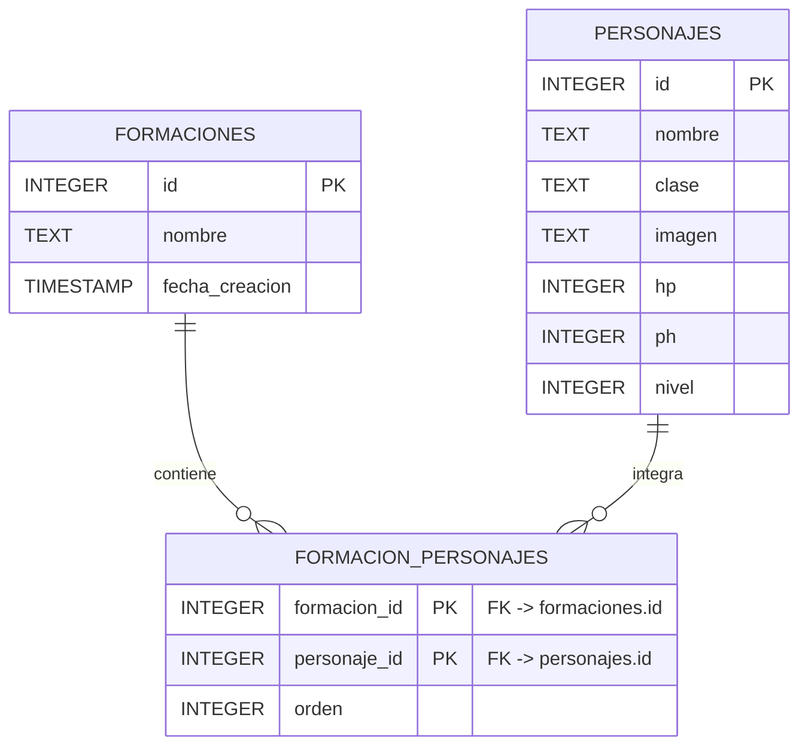

# OctoFormations (Octoweb)

Aplicación web desarrollada con **Flask** y **SQLite** para crear, consultar, editar y eliminar formaciones de **4 personajes** inspiradas en *Octopath Traveler*. Presenta una interfaz oscura de estética RPG clásica con marcos metálicos dorados, tarjetas translúcidas y visualización de estadísticas de cada personaje (`HP` y `PH`).


---

## Tabla de contenidos

- [Características principales](#características-principales)
- [Estructura del proyecto](#estructura-del-proyecto)
- [Elenco de personajes](#elenco-de-personajes)
- [Esquema de base de datos](#esquema-de-base-de-datos)
- [Rutas de la aplicación](#rutas-de-la-aplicación)
- [Instalación y ejecución](#instalación-y-ejecución)
- [Detalles de interfaz y diseño](#detalles-de-interfaz-y-diseño)

---

## Características principales

- **Gestión CRUD completa de formaciones:**
  - **Listar:** Visualiza todas las formaciones ordenadas cronológicamente por fecha de creación junto con las miniaturas de sus integrantes.
  - **Crear:** Permite asignar un nombre opcional y seleccionar exactamente **4 personajes** de los 8 disponibles. Si no se especifica nombre, la interfaz muestra automáticamente `Formacion #<num>`.
  - **Ver en detalle:** Presenta la formación en una cuadrícula `2x2` con retratos ampliados, clase y barras proporcionales de `HP` y `PH`.
  - **Editar:** Precarga el nombre y los personajes actuales de la formación para modificarlos conservando el orden de selección.
  - **Eliminar:** Permite borrar una formación tras confirmación del usuario en el navegador.
- **Validación en cliente y servidor:** El formulario impide el envío mediante JavaScript hasta completar exactamente `4/4` personajes seleccionados, y el backend valida igualmente la longitud de la selección antes de escribir en la base de datos.
- **Tolerancia a fallos en imágenes:** Las plantillas incluyen un *fallback* automático en SVG con las iniciales del personaje (o `?` en la vista general) si falla la carga de la imagen estática.
- **Diseño adaptable (*Responsive*):** La cuadrícula de selección pasa de 4 columnas en escritorio a 2 columnas en pantallas medianas (`<= 1000px`) y 1 columna en móviles (`<= 600px`); la vista detalle `2x2` se adapta a 1 columna por debajo de `800px`.

---

## Estructura del proyecto

```text
octoweb/
├── app.py                      # Servidor Flask, conexión SQLite y rutas CRUD
├── init_db.py                  # Script de creación de tablas y carga inicial de personajes
├── database.db                 # Base de datos SQLite del proyecto
├── static/
│   ├── css/
│   │   └── style.css           # Hoja de estilos (tema oscuro, bordes dorados y barras)
│   └── imagenes/
│       ├── logo.png            # Logotipo principal de la barra de navegación
│       ├── alfyn.png           # Retrato de Alfyn
│       ├── cyrus.png           # Retrato de Cyrus
│       ├── haanit.png          # Retrato de H'aanit
│       ├── olberic.png         # Retrato de Olberic
│       ├── ophilia.png         # Retrato de Ophilia
│       ├── primrose.png        # Retrato de Primrose
│       ├── therion.png         # Retrato de Therion
│       └── tressa.png          # Retrato de Tressa
└── templates/
    ├── base.html               # Plantilla base (navbar, fuentes y script de barras)
    ├── index.html              # Listado de formaciones creadas y estado vacío
    ├── crear.html              # Formulario para crear una nueva formación
    ├── ver.html                # Vista detallada 2x2 de una formación
    └── editar.html             # Formulario para actualizar una formación existente
```

---

## Elenco de personajes

El script [`init_db.py`](init_db.py) define los 8 personajes base precargados en la tabla `personajes`:

| Personaje | Clase | HP | PH | Imagen |
| :--- | :--- | :---: | :---: | :--- |
| **Ophilia** | Clerigo | 280 | 350 | `static/imagenes/ophilia.png` |
| **Cyrus** | Erudito | 240 | 380 | `static/imagenes/cyrus.png` |
| **Olberic** | Guerrero | 420 | 180 | `static/imagenes/olberic.png` |
| **Alfyn** | Boticario | 300 | 300 | `static/imagenes/alfyn.png` |
| **H'aanit** | Cazador | 320 | 280 | `static/imagenes/haanit.png` |
| **Tressa** | Mercader | 290 | 260 | `static/imagenes/tressa.png` |
| **Therion** | Ladron | 270 | 240 | `static/imagenes/therion.png` |
| **Primrose** | Bailarin | 260 | 320 | `static/imagenes/primrose.png` |

---

## Esquema de base de datos

La persistencia se gestiona con **SQLite** en [`database.db`](database.db), habilitando integridad referencial en cada conexión mediante `PRAGMA foreign_keys = ON`.



- **`personajes`**: Almacena los datos base de cada personaje (`nombre`, `clase`, `imagen`, `hp`, `ph` y `nivel` con valor por defecto `1`).
- **`formaciones`**: Guarda cada equipo creado con su `nombre` (opcional) y `fecha_creacion` automática (`CURRENT_TIMESTAMP`).
- **`formacion_personajes`**: Tabla intermedia con clave primaria compuesta `(formacion_id, personaje_id)` que conserva el orden de los 4 integrantes (`orden` de `1` a `4`) y define `ON DELETE CASCADE` sobre `formacion_id`.

---

## Rutas de la aplicación

Todas las rutas están definidas en [`app.py`](app.py):

| Método | Ruta | Función | Descripción |
| :--- | :--- | :--- | :--- |
| `GET` | `/` | `index` | Muestra el listado de formaciones registradas y las miniaturas de sus personajes. |
| `GET`, `POST` | `/crear` | `crear` | Renderiza el selector de personajes y guarda una nueva formación con exactamente 4 integrantes. |
| `GET` | `/formacion/<int:id>` | `ver` | Muestra el detalle en formato `2x2` de la formación indicada (redirige a `/` si no existe). |
| `GET`, `POST` | `/editar/<int:id>` | `editar` | Permite modificar el nombre y los 4 personajes de una formación existente. |
| `POST` | `/eliminar/<int:id>` | `eliminar` | Elimina la formación y sus relaciones asociadas, redirigiendo al inicio. |

---

## Instalación y ejecución

### Requisitos previos

- **Python 3.x**
- **Flask**

### Pasos para ejecutar en local

1. **Clonar el repositorio:**

   ```bash
   git clone https://github.com/kipdeveloping/octopath-web.git
   cd octopath-web
   ```

2. **Crear y activar un entorno virtual (recomendado):**

   En Windows (PowerShell):
   ```powershell
   python -m venv .venv
   .\.venv\Scripts\Activate.ps1
   ```

   En Linux / macOS:
   ```bash
   python3 -m venv .venv
   source .venv/bin/activate
   ```

3. **Instalar dependencias:**

   ```bash
   pip install flask
   ```

4. **Base de datos (`database.db`):**

   El repositorio ya incluye el archivo `database.db` listo para usar. Si deseas crear o regenerar la base de datos desde cero, elimina `database.db` y ejecuta:

   ```bash
   python init_db.py
   ```

   > **Nota:** Ejecuta `init_db.py` únicamente sobre una base de datos nueva o vacía, ya que la tabla `personajes` no tiene restricción de unicidad sobre `nombre` y volver a ejecutarlo insertaría personajes duplicados.

5. **Iniciar el servidor de desarrollo:**

   ```bash
   python app.py
   ```

6. **Abrir en el navegador:**

   Accede a `http://127.0.0.1:5000` (Flask se inicia con `debug=True`).

---

## Detalles de interfaz y diseño

- **Tipografía:** Carga **Cinzel** (títulos, botones y nombres) y **Crimson Text** (cuerpo y descripciones) desde Google Fonts en [`templates/base.html`](templates/base.html).
- **Sistema visual ([`static/css/style.css`](static/css/style.css)):** Fondo radial oscuro (`#111` a `#000`), paneles translúcidos (`rgba(26, 26, 26, 0.75)` con `backdrop-filter`), bordes dobles metálicos dorados (`#c5a059` y `#8a6d3b`) y acentos ornamentales en las tarjetas.
- **Barras de estado:** Las plantillas calculan el porcentaje de `HP` y `PH` sobre una escala de referencia de `400` en el atributo `data-width`, y un script en `base.html` aplica dinámicamente el ancho de cada barra al cargar la vista.
